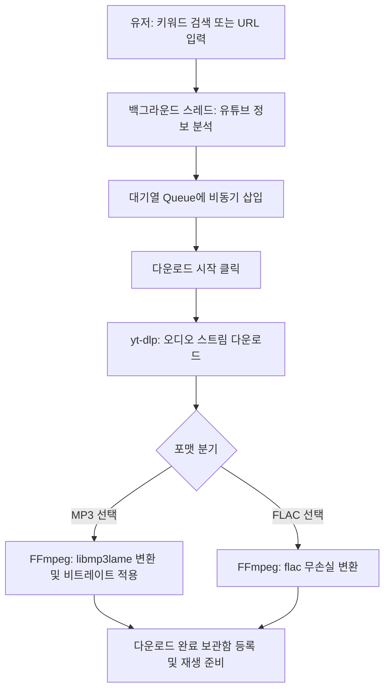

# 🎵 YouTube Music Downloader (유튜브 음악 다운로더)

유튜브에서 음악을 검색하고 선택한 여러 곡을 **MP3 · FLAC · MP4** 로 일괄 다운로드하는 윈도우 데스크톱 앱입니다.

개인용 MP3 플레이어에 음악을 담아 오프라인으로 듣고 싶은 사용자를 위해 만들었습니다.

> 2.0 부터 화면은 Tauri(웹뷰) + React, 다운로드 엔진은 Python(FastAPI + yt-dlp) 백엔드로 바뀌었습니다.
> 구조는 `jamak_converter` 와 같습니다.

---

## ⬇️ 빠른 시작 (설치 파일)

**➡️ [최신 버전 다운로드](https://github.com/al8bright/utube-downloader/releases/latest)**

1. `YoutubeDownloader_<버전>_x64-setup.exe` 를 내려받아 실행합니다.
2. 관리자 권한 없이 현재 사용자에게 설치되고, 시작 메뉴에 등록됩니다.

> 변환에 쓰는 FFmpeg 가 설치 파일 안에 들어 있어 따로 설치할 것이 없습니다.
> 설정은 `%APPDATA%\YoutubeDownloader\settings.json` 에 저장됩니다.

### 시스템 요구사항

| 항목 | 내용 |
| :--- | :--- |
| **OS** | Windows 10 / 11 (WebView2. Windows 11 에는 기본 포함, 10 에서 없으면 설치 중 자동으로 받음) |
| **FFmpeg** | 설치 파일에 포함. 소스로 실행할 때만 따로 설치 (`winget install Gyan.FFmpeg`) |
| **Deno** | 설치 파일에 포함(유튜브 서명 계산용). 소스로 실행할 때는 없어도 되지만 있으면 더 안정적 (`winget install DenoLand.Deno`) |

### ❓ 다운로드가 403(Forbidden)으로 실패한다면

유튜브는 다운로드 주소의 서명 방식을 자주 바꿉니다. 앱에 들어 있는 `yt-dlp` 가 오래되면 그 주소가 거부되어 `HTTP Error 403: Forbidden` 이 납니다.

* **설치해서 쓰는 경우**: 최신 릴리스로 다시 설치하면 해결됩니다.
* **소스로 실행하는 경우**: `cd backend; uv lock --upgrade-package yt-dlp; uv sync`
* 빌드 스크립트는 설치 파일을 만들 때마다 `yt-dlp` 를 최신으로 올립니다.

> 유튜브는 다운로드 주소의 서명을 JavaScript 로 계산하게 합니다. 설치 파일에는 이를 위한 Deno 가 들어 있고,
> 소스로 실행할 때는 PATH 에 있는 Deno · Node.js 를 자동으로 찾아 씁니다.

---

## ✨ 주요 기능

* **🔍 편리한 유튜브 검색**: 영상의 URL 링크를 매번 찾을 필요 없이, 검색창에 곡명이나 가수명 등 키워드를 입력해 유튜브 영상을 즉시 검색할 수 있습니다.
* **📥 비동기 대기열 (Queue) 시스템**: 검색 결과 목록에서 여러 곡을 선택(체크)해 대기열에 담아둘 수 있으며, 분석 및 다운로드 중에도 UI가 멈추지 않습니다.
* **🔗 유튜브 링크 직접 추가**: 검색창에 유튜브 링크를 붙여넣으면 검색하지 않고 바로 대기열에 담아 백그라운드에서 분석합니다.
* **👀 어디서나 보이는 진행 상황**: 어느 화면에서든 아래쪽 '받는 중' 줄에 지금 받는 곡과 진행률이 보여, 받는 동안에도 다음 곡을 검색해 담을 수 있습니다.
* **🔄 일괄(배치) 순차 다운로드**: 대기열에 쌓인 음악들을 차례대로 일괄 다운로드하여 변환합니다. 변환 중에도 중단하면 곧바로 멈춥니다.
* **🎧 다양한 포맷 지원**:
  * **MP3**: 고음질 320kbps / 256kbps / 192kbps 비트레이트 선택 가능
  * **FLAC**: 무손실 압축 음원 포맷
  * **MP4**: 가장 좋은 화질의 영상과 음성을 합친 영상 파일
* **🎵 받은 파일 관리**: 음성·영상 화면에서 크기와 받은 날을 보고, 파일 이름으로 찾거나 정렬할 수 있습니다. 재생 버튼으로 기본 플레이어에서 바로 듣고, 필요 없는 파일은 삭제합니다.
* **📂 저장 폴더 지정 및 원클릭 열기**: 저장할 폴더를 직접 선택할 수 있으며(기본값은 내 `음악` 폴더), 해당 폴더를 윈도우 탐색기로 즉시 열 수 있습니다.

---

## 🔄 시스템 작동 흐름도



---

## 🎨 화면 구성

왼쪽 사이드바로 화면 4개를 오갑니다. 사이드바는 위쪽 버튼으로 접고 펼 수 있고, 다음 실행에도 그 상태로 열립니다.
디자인은 jamak_converter 와 같은 네온 계열(서울 나이트 팔레트)이며, 색·서체·배치 규칙은 [DESIGN.md](DESIGN.md)에 있습니다.

```
+-------------+---------------------------------------------------------+
| ▶ MUSIC DL  |  QUEUE · 8곡 · 대기 3 · 받는 중 1 · 완료 2 · 문제 2        |
|        [<]  |  대기열                                                  |
| 찾기         |  +- NOW · 3 / 6곡째 ----------------+ +- 받는 방법 -------+ |
|  검색    6   |  | IU '이 별로부터' MV          62% | | [MP3|FLAC|MP4]    | |
|  대기열 ● 8  |  | 1 분석 ✓  2 다운로드  3 변환       | | 320kbps  저장 위치 | |
| 받은 파일     |  | 전체 [=======>        ] 33%      | +-------------------+ |
|  음성    6   |  +----------------------------------+                      |
|  영상    2   |  [ ] 3곡 선택        [전체 8][대기 3][완료 2][문제 2] [링크] |
|             |  # 제목                          길이   상태               |
|             |  1 IU 'Love wins all' MV         04:32  [완료]             |
|             |  3 IU '이 별로부터' MV            04:59  [다운로드 중 62%]  |
|             |  7 IU 'Shopper' Live Clip        03:22  [실패] 사유        |
|             |  완료 항목 정리  대기열 비우기               [다운로드 중단]  |
| V2.0.0      |  ● 백엔드 연결됨 · 받는 중  QUEUE 33%   yt-dlp … · FFmpeg   |
+-------------+---------------------------------------------------------+
```

대기열이 아닌 화면에서 받는 중이면, 맨 아래 상태 줄 위에 '받는 중' 한 줄(곡 이름 · 진행 바 · 속도 · 대기열 보기 · 중단)이 붙습니다.

| 화면 | 하는 일 |
| :--- | :--- |
| **검색** | 키워드로 찾거나 링크를 붙여넣어 곡을 대기열에 담습니다. 이미 담은 곡은 흐리게 표시됩니다. |
| **대기열** | 형식·음질·저장 위치를 정하고 받기를 시작합니다. 받는 중에는 현재 곡의 단계와 진행률이 보입니다. |
| **음성 · 영상** | 받은 파일을 찾고, 정렬하고, 재생하거나 삭제합니다. 이번에 받은 파일에는 '새로 받음'이 붙습니다. |

---

## 🛠️ 기술 스택

| 분류 | 기술 | 용도 |
| :--- | :--- | :--- |
| **앱 껍데기** | Tauri 2 (Rust) | 창, 설치 파일(NSIS), 백엔드 실행·종료 관리, 폴더 선택 창 |
| **화면** | React 19 · TypeScript · Vite | 사이드바와 화면 4개. 디자인 규칙은 [DESIGN.md](DESIGN.md) |
| **백엔드** | Python 3.13 · FastAPI · uvicorn | 검색·대기열·다운로드 상태를 들고 HTTP/WebSocket 으로 화면에 알림 |
| **다운로더** | `yt-dlp` (+ `yt-dlp-ejs`) | 유튜브 검색, 스트림 추출과 다운로드 |
| **변환** | FFmpeg | MP3/FLAC 인코딩, MP4 영상·음성 병합. 설치 파일에 포함 |
| **패키징** | PyInstaller · uv · pnpm | 백엔드를 실행 파일로 묶고 의존성을 고정 |

```
Tauri 창 (React)  ──HTTP / WebSocket(127.0.0.1, 실행마다 바뀌는 토큰)──▶  utube-backend.exe ──▶ yt-dlp ──▶ ffmpeg.exe
       │ 시작할 때 백엔드를 띄우고, 창을 닫으면 함께 끝낸다
```

백엔드는 127.0.0.1 에만 열리고, Tauri 가 실행마다 새로 만든 토큰이 없으면 요청을 거절합니다.
앱이 어떻게 끝나든(강제 종료 포함) 백엔드와 변환 중이던 FFmpeg 는 함께 정리됩니다.

---

## 🚀 소스로 실행하기 (개발자용)

필요한 것: [uv](https://docs.astral.sh/uv/), [pnpm](https://pnpm.io/), Rust(stable, MSVC), FFmpeg

```powershell
cd app
pnpm install
pnpm tauri dev      # 화면(Vite, 5174 포트)과 백엔드(uv run utube serve)를 함께 띄운다
```

백엔드만 따로 띄워 브라우저로 볼 수도 있습니다.

```powershell
cd backend; uv run utube serve        # http://127.0.0.1:8766
cd app;     pnpm dev                  # http://localhost:5174
cd backend; uv run utube doctor       # yt-dlp · FFmpeg · JS 실행기 점검
```

### 설치 파일 만들기

```powershell
.\scripts\build_app.ps1
```

1. `yt-dlp` 를 최신으로 올리고(`backend/uv.lock` 이 바뀌면 함께 커밋) 백엔드를 PyInstaller 로 묶습니다.
2. 빌드하는 PC 의 **진짜 `ffmpeg.exe`** 를 찾아 백엔드 옆에 넣습니다. `FFMPEG_DIR` → PATH → chocolatey → scoop → winget 순으로 찾고,
   chocolatey 가 PATH 에 두는 작은 대리 실행 파일(shim)은 건너뜁니다. ffprobe 는 필요 없습니다.
3. **Deno** 도 백엔드 옆에 넣습니다. `DENO_EXE` → PATH → `~\.deno\bin` → scoop → winget 순으로 찾고,
   없으면 GitHub 공식 릴리스(denoland/deno)에서 받아 SHA-256 을 확인한 뒤 `backend\.tools` 에 보관합니다.
4. `utube-backend.exe doctor --bundled` 로 yt-dlp · 서명 스크립트 · FFmpeg · Deno 가 다 들어갔는지 확인합니다.
5. Tauri 로 NSIS 설치 파일을 만듭니다: `app\src-tauri\target\release\bundle\nsis\`

앱 아이콘은 `app/app-icon.svg` 가 원본입니다. 바꾸면 `cd app; pnpm tauri icon app-icon.svg` 로 `src-tauri/icons` 를 다시 만듭니다.

GitHub 에 푸시하면 `.github/workflows/ci.yml` 이 백엔드 테스트 · ruff, 화면 타입 검사 · 린트 · 빌드, `cargo check` 를 돌립니다.

### 테스트

```powershell
cd backend; uv run pytest; uv run ruff check
cd app;     pnpm exec tsc -b; pnpm lint
```

백엔드 테스트는 yt-dlp 를 가짜로 바꿔 네트워크 없이 1초 안에 끝납니다.

---

## 📝 파일 구성

| 경로 | 내용 |
| :--- | :--- |
| `app/src/` | 화면. `App.tsx` 틀·사이드바 · `Search.tsx` · `Queue.tsx` · `Files.tsx` · `ui.tsx` 공통 부품 · `api.ts` 백엔드 연결 · `format.ts` 표시 문자열 · `index.css` 디자인 토큰 |
| `app/src-tauri/` | Tauri 셸. `src/lib.rs` 가 백엔드를 띄우고 주소·토큰을 화면에 넘긴다 |
| `backend/src/utube/core/service.py` | 검색·대기열·배치 상태 기계 |
| `backend/src/utube/core/` | `ytdl.py` yt-dlp 연동 · `storage.py` 저장 폴더·파일 · `urls.py` 링크 해석 · `text.py` 표시 문자열 · `proc.py` 프로세스 관리 |
| `backend/src/utube/api/server.py` | HTTP/WebSocket API |
| `backend/packaging/` | PyInstaller 설정 |
| `backend/tests/` | 백엔드 테스트 |
| `scripts/build_app.ps1` | 설치 파일 빌드 |
| `.github/workflows/ci.yml` | 푸시·PR 검사 |
